# ASIC Explorer

**An open-source interactive learning environment for digital logic and ASIC design concepts.**

**[Open the live demo](https://asic-explorer-narimanmani-a1aa7fa79bdd.herokuapp.com/#intent)** · [Initial release](https://github.com/narimanmani/ASIC-Explorer/releases/tag/v1.0.0)

A Next.js lecture companion for **ASIC Design Flow: From RTL to Physical Chip Design**. Use it beside the tutorial and slides: explain a concept, ask students to predict a result, then demonstrate it in the app.

Designed for classroom demonstrations, practical exercises, and self-directed learning, including students approaching hardware from a software background. Begin with one counter and the three jobs **store, calculate, update**, then follow its behavior into synthesized circuit representations.

Developed by **Nariman Mani** for a teaching lecture and released so other educators can use and extend it. It builds on the open-source synthesis, simulation, editor, and layout projects credited below.

## Start the app

Requires **Node.js 22 LTS (22.19 or later in the 22.x line)**, npm, and a desktop browser. From a terminal:

```sh
git clone https://github.com/narimanmani/ASIC-Explorer.git
cd ASIC-Explorer
npm ci
npm run build
npm start
```

Open **http://127.0.0.1:4175**. Keep the server terminal running. `Start-ASIC-Explorer.cmd` opens a running instance, or installs missing dependencies, builds if needed, and starts the app in your default browser.

`npm ci` copies Monaco's assets into `public/monaco/`; the editor, examples, system fonts, simulator, and tutorial then load locally. The synthesis tool is included in the npm dependencies. No separate native Yosys installation, account, API key, or editor CDN is required. Installation downloads packages from npm; after installation, classroom interaction and synthesis run locally. A running local Node server is required for synthesis and to serve the app; this is not a static-only export.

Browser verification currently covers the Chromium-based Codex in-app browser on Windows, with mouse and keyboard interaction and responsive layout checks. Firefox and Safari have not been verified. Use a desktop browser and the production build for a lecture; the responsive layout checks do not establish mobile browser or screen-reader compatibility.

For development, use `npm run dev` (the same port). Use the production build when presenting. If you change the editor component during development and Monaco reports a disposed service, reload the page after hot refresh.

## What works

- The opening Design intent lesson now has a live counter: Step clock, Enable, Reset, and Start over. It shares the real simulator state with the RTL workspace and explains what each control means. It preserves other selected examples/edited source and offers an explicit Load four-bit counter action.
- An editable SystemVerilog source pane, top-module selection, real Yosys synthesis, source diagnostics, and a synthesis report.
- Word-level and generic gate-level circuits derived from the compiled netlists. AND, OR, XOR, inverter, mux, and flip-flop symbols show actual settled signal values. Select a component to highlight source associations supplied by Yosys.
- DigitalJS event-driven simulation in both abstractions. The counter supports synchronous reset, enable, modulo wrap, manual clock cycles, and human-paced autoplay. Five prepared examples also include increment-by-two, asynchronous reset, a mux, and a combinational gate network.
- Linked settled-value waveforms, decimal/binary outputs, SVG circuit export, and CSV trace export.
- A setup/hold timing experiment matching the tutorial: pre-route setup slack +0.30 ns, post-route setup slack −0.05 ns, and a −0.04 ns hold example. Period, maximum wire delay, capture skew, and added buffer delay are adjustable.
- A six-cell conceptual floorplan with mouse/keyboard movement and measured Manhattan connection length; utilization illustrations; a clock-tree comparison; routing layers, vias, and an RC overlay; and toy DRC/LVS examples.
- Eight lessons with a default **Guided view**: one prediction, action, observation, and explanation at a time. **Full lab** retains the detailed workspace. Teaching notes follow the same 36-minute route as the slides. The embedded tutorial includes a four-page beginner primer and 25 TikZ figures in PDF/PNG form.

## Screenshots and classroom walkthrough

These ten screenshots were captured from the running production app on **October 12, 2026**. They cover all **eight lessons**, the actual synthesis report, and the instructor notes. Expand a screenshot below to see its controls and example outcome. Each image is stored locally in [docs/screenshots](docs/screenshots/), so the gallery can travel with the source and render on GitHub without an external image host.

**What the screenshots represent:** the RTL, word-level netlist, generic gate-level netlist, and synthesis log come from **Yosys**, distributed through **YoWASP**. Live logical values and settled-event waveforms come from **DigitalJS**. Circuit drawing positions are a visualization of those netlists. Timing, placement, clock-tree, routing/RC, and DRC/LVS screens use **independent illustrative models**; they do not implement the edited RTL physically or run foundry-qualified tools. The app supports introductory teaching alongside an EDA lab; it does not establish equivalence to a commercial ASIC implementation or signoff suite.

### RTL beside its circuit and waveform

The counter has reached **2 / 0010** after two enabled rising edges. Selecting the adder highlights the associated RTL statement and explains the difference between calculating a value and storing it. The waveform records logical simulation events, rather than measured silicon delays.

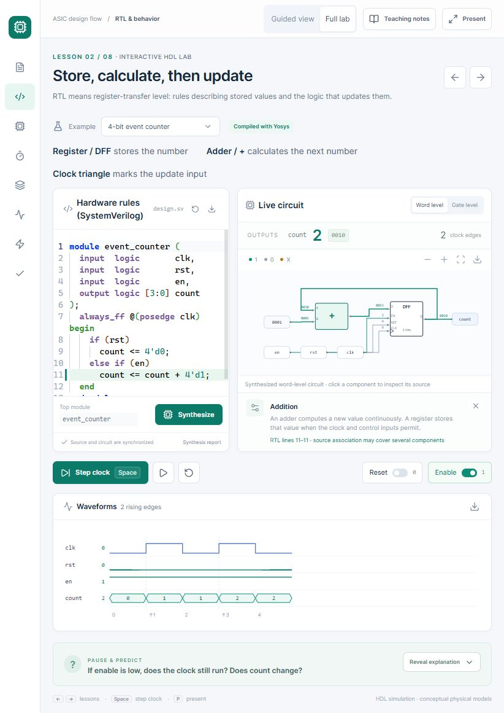

**Try:** Open `/#rtl`, select **4-bit event counter**, choose **Word level**, restart, and step twice. Click the adder. Turn Enable off and step again; the stored count stays 2.

<details>
<summary><strong>1. Design intent: a live counter and guided practice</strong></summary>

The opening lesson introduces decimal and four-bit binary values before the code. This screenshot shows **2 / 0010**, Enable off, and three clock edges: the third edge occurred, but counting was not permitted.

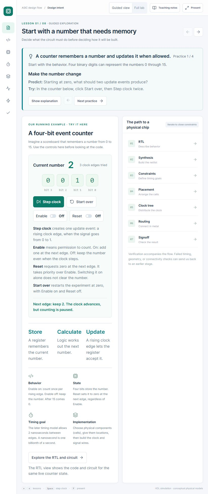

**Try:** Open `/#intent`, click **Start over**, step twice, turn **Enable** off, then step again. Turn **Reset** on and observe that the old value remains until the next edge; that edge clears it to zero.

</details>

<details>
<summary><strong>2. Gates and mapping: switch circuit representations</strong></summary>

The same counter is shown as smaller logic elements with gate and flip-flop symbols. Switching from Word level to Gate level preserves the simulation state; a further enabled edge takes the count from 2 to **3 / 0011**. These are generic mapped gates, without a foundry standard-cell library.

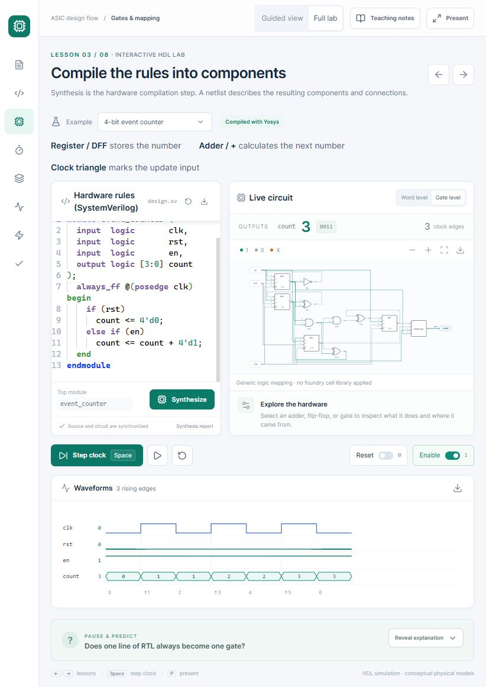

**Try:** Open `/#synthesis` and switch between **Word level** and **Gate level**. Step the clock, inspect a component, and use **Fit circuit** or the zoom controls to explore its connections. To change the rule, edit `count + 4'd1` to `count + 4'd2`, click **Synthesize**, then step twice to obtain 2 and 4. Restore the prepared example afterward.

</details>

<details>
<summary><strong>3. Synthesis report: inspect real tool output</strong></summary>

This report was captured after clicking **Synthesize**, with the prepared counter source unchanged. Yosys reports **2 word-level cells** and **10 generic mapped cells** for this run, and the app displays the engine version and compilation log. These counts describe different abstractions, not chip area or transistor counts.

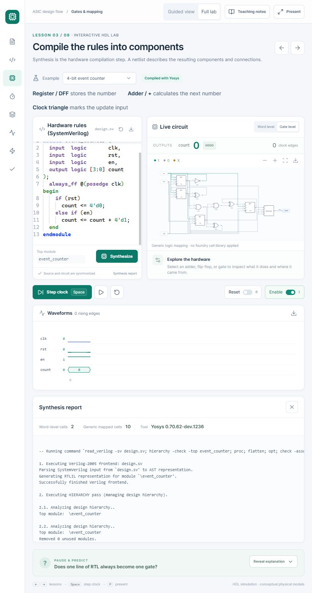

**Try:** In the RTL or synthesis lesson, check **Top module**, click **Synthesize**, and open **Synthesis report**. Compare the tool log with the circuit view. Successful synthesis checks the hardware description; it does not prove every intended behavior or physical constraint.

</details>

<details>
<summary><strong>4. Timing: compare arrival with a deadline</strong></summary>

The **After routing** preset places the latest arrival at **1.60 ns** against a **1.55 ns** deadline, producing **−0.05 ns setup slack**. The separate hold case remains at **−0.04 ns**. Sliders expose the illustrative period, wire delay, skew, and buffer-delay assumptions.

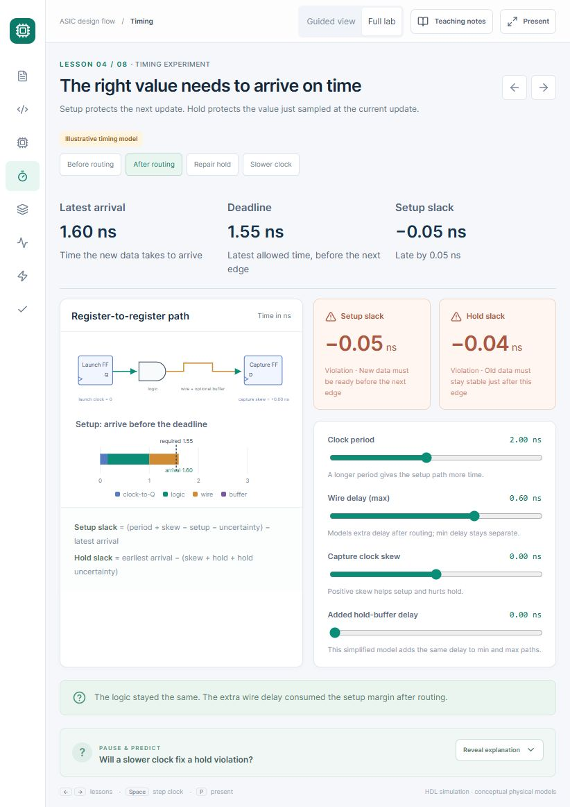

**Try:** Open `/#timing` and compare **Before routing** with **After routing**. Try **Slower clock**, then **Repair hold**; observe why improving setup and repairing hold are different tasks. In Guided view, choose **Show equations and sliders** to reveal the detailed controls. Each preset starts its own case.

</details>

<details>
<summary><strong>5. Floorplan and placement: move connected cells</strong></summary>

The compact six-cell arrangement measures **455 teaching units** of Manhattan connection length, compared with **1020** in the reset arrangement. Students can move cells with the mouse or keyboard and illustrate occupied space using the utilization slider. Distance is measured in this drawing; silicon delay and routing congestion are not calculated.

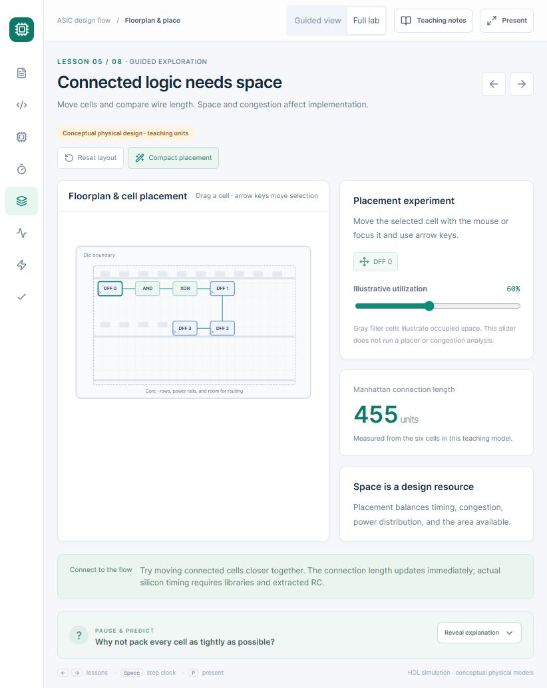

**Try:** Open `/#floorplan`, click **Reset layout**, note the length, then click **Compact placement**. Move a cell and watch the measurement change. Raise illustrative utilization and discuss why a real layout needs room for wires, clock buffers, and repairs.

</details>

<details>
<summary><strong>6. Clock tree: distribute an update signal</strong></summary>

The symmetric buffered-tree illustration assigns all four sinks an arrival of **0.20 ns**, giving a displayed spread of **0.00 ns**. These are teaching values; equal arrival labels in this drawing do not establish a balanced clock under real loads.

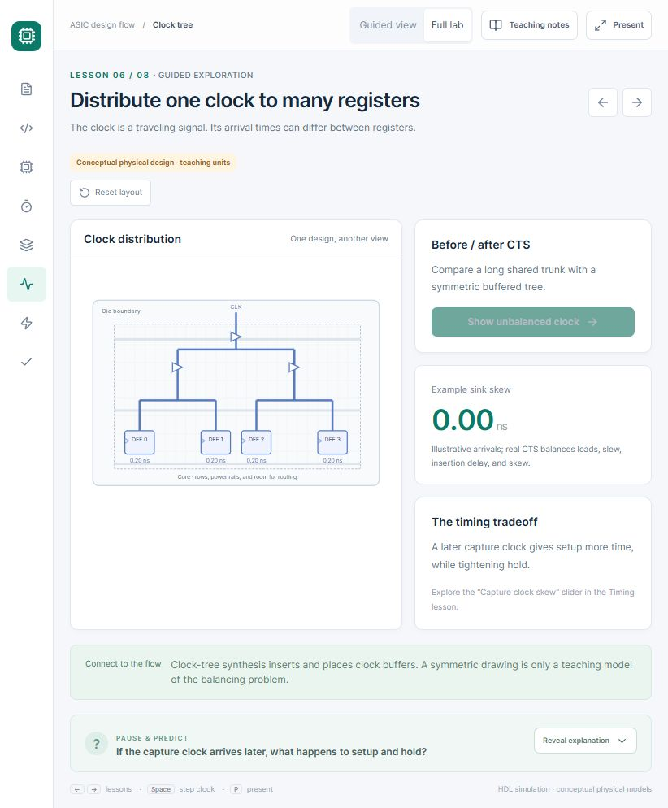

**Try:** Open `/#clock`, click **Reset layout**, compare the four arrival labels, then choose **Build balanced clock tree**. Return to Timing and vary capture skew to explore its opposing effects on setup and hold.

</details>

<details>
<summary><strong>7. Routing and parasitics: layers, vias, resistance, and capacitance</strong></summary>

The diagram uses M2 for horizontal segments, M3 for vertical segments, and small squares for vias. The revealed R/C symbols explain why a physical wire can add delay. They are a conceptual overlay, rather than extracted parasitic values from a routed counter.

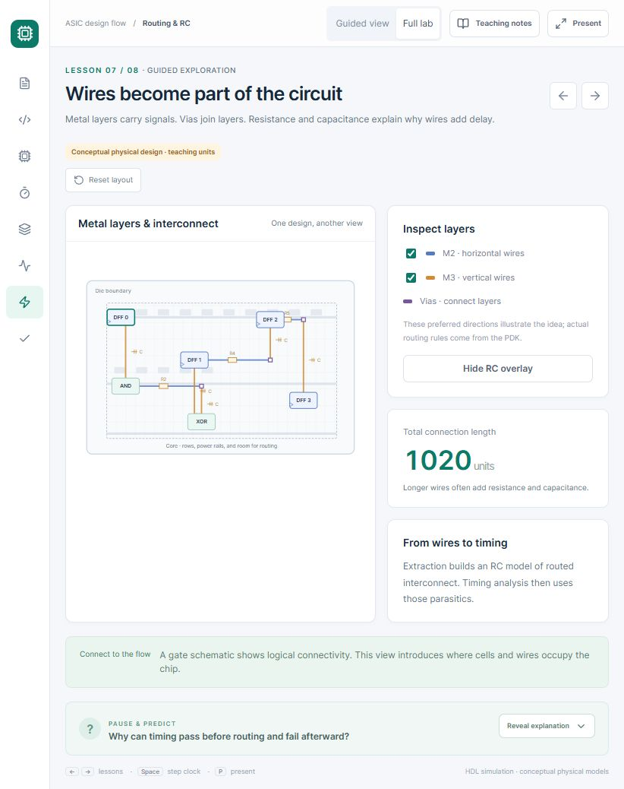

**Try:** Open `/#routing`, toggle **M2** off and on, locate the vias between layers, then click **Reveal parasitic RC**. Explain how logical connectivity becomes geometry, and how geometry later informs timing analysis.

</details>

<details>
<summary><strong>8. Signoff concepts: geometry and connectivity answer different questions</strong></summary>

The **Broken connection** case displays **DRC PASS / LVS FAIL**: an open wire can satisfy the toy spacing rule while missing an expected connection. These outcomes belong to prepared examples; no DRC or LVS engine runs here.

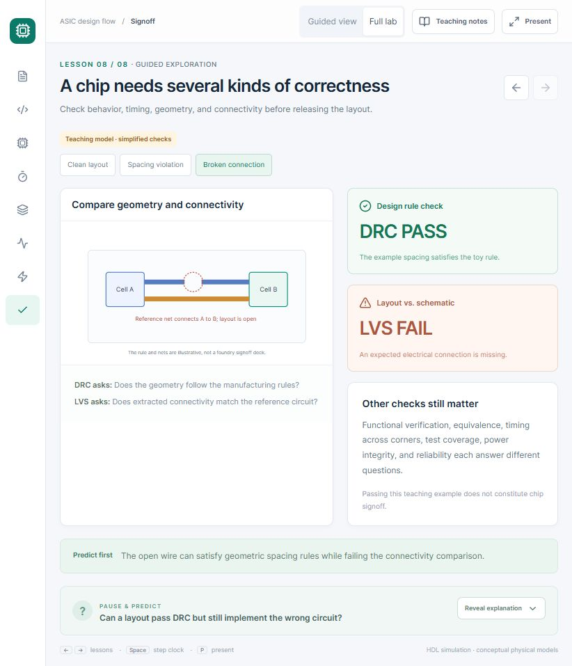

**Try:** Open `/#signoff`, predict the results of **Spacing violation** and **Broken connection**, then select each. Finish with **Clean layout**. Discuss why passing geometry and connectivity checks still does not prove functionality, timing, or manufacturing readiness.

</details>

<details>
<summary><strong>9. Teaching notes: connect the app with slides and reusable figures</strong></summary>

Each lesson's notes offer a demonstration cue, an explanation, a bridge back to slides, and an original tutorial figure. The figure PDF and full tutorial can be opened from the dialog. The displayed lecture times are suggested presentation windows, not an automatic timer.

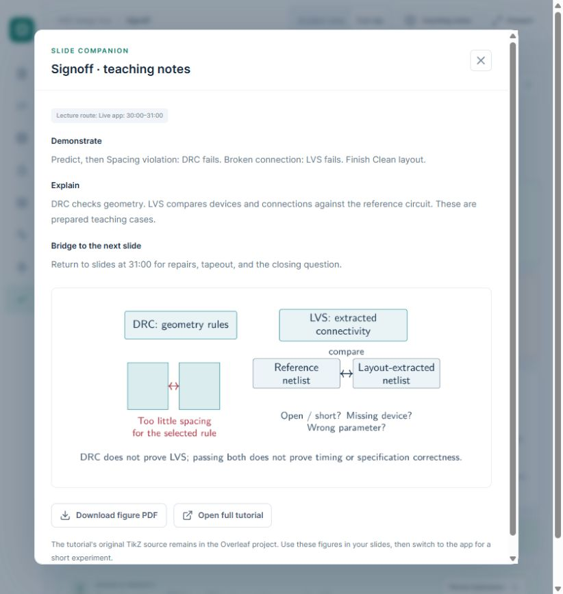

**Try:** Click **Teaching notes** or press **N** outside the editor. Read the suggested experiment, download its figure for slides, then close the notes and let students predict the result before demonstrating it.

</details>

### Five prepared RTL examples

The app has **eight teaching lessons**, not eight prepared HDL designs. The **Example** selector in the RTL and synthesis lessons contains these five designs:

| Example | Suggested experiment |
| --- | --- |
| 4-bit event counter | Step, pause counting with Enable, request synchronous reset, and observe 15 wrapping to 0. |
| Counter · increment by 2 | Step through 0, 2, 4, … and explain why the least significant bit stays zero from this initial state. |
| Counter · asynchronous reset | Assert Reset between clock edges and compare the immediate clear with the synchronous counter. |
| 2-to-1 multiplexer | Set different values on `a` and `b`, then toggle `sel` to choose which reaches `y`. No clock is required. |
| Combinational gate network | Predict `y = (a & b) ^ c`, change the three inputs, and compare the RTL expression with AND/XOR symbols. |

Both Guided view and Full lab use the same compiled circuit and simulation state. The physical-design lessons keep their own teaching models. See [Interpretation and supported scope](#interpretation-and-supported-scope) for the implementation limits.

## Present alongside slides

Try the first experiment directly on `/#intent`: click **Start over**, then **Step clock** twice to get 2. Switch **Enable** off and step again: the number stays 2. Enable means permission to count; turning it off does not stop the clock or power down the circuit. Switch **Reset** on: the number remains 2 until the next Step clock, when it becomes 0. Start over restores zero, Enable on, and Reset off. **Explore the RTL and circuit** carries the current counter state into the code/circuit workspace.

Start in **Guided view**, choose **Show explanation** after an experiment, and use **Next practice** for the following step. Counter-specific instructions appear only for the unedited prepared counter. Custom source and other examples get an open experiment prompt. In Timing, **Show equations and sliders** reveals the detailed controls; switching to Full lab retains the current model values.

The deck budgets 27 core slides for 36 minutes and keeps four minutes for interruptions/questions. Six app visits total 8.5 minutes inside that core:

| Lecture time | App demonstration |
| --- | --- |
| 7:00–9:00 | RTL: restart, step twice, disable enable, then assert reset before the next edge. |
| 11:30–12:30 | Synthesis: inspect the adder, switch from Word level to Gate level, then step once. |
| 18:00–20:00 | Timing: compare Before routing / After routing; Slower clock leaves hold unchanged; Repair hold adds delay. Each preset starts a separate case. |
| 22:30–23:30 | Floorplan: Reset layout, then Compact placement; compare 1020 and 455 teaching units. |
| 26:00–27:30 | Clock: Build balanced clock tree; at 26:40 switch to Routing, toggle metal visibility, identify vias, and Reveal parasitic RC. |
| 30:00–31:00 | Signoff: compare Spacing violation, Broken connection, and Clean layout. |

These are rehearsal budgets, not a measured lecture duration. They reflect the original companion lecture's slide and app route; a PowerPoint deck is not included in this app repository. Teaching notes also show a simpler timing diagram in Guided view. Read the bundled tutorial's **Start here** primer before the detailed reference material.

Use **Present** to enlarge code and simplify navigation. Use browser full screen if helpful. Circuit controls zoom, fit, and export; drag the diagram background to pan when zoomed. Source and simulator state remain while you move between lessons. Selecting an example or synthesizing a new source resets its simulation through an initialization reset edge where the design has a `rst` input.

Keyboard shortcuts (outside the editor and form inputs): **Space** steps one clock cycle; **R** restarts simulation; **P** toggles presentation mode; **N** opens notes; **←/→** and **1–8** navigate lessons. Use Enter or Space on a focused circuit component. For placement, focus a cell and use arrow keys.

Direct lesson links: `/#intent`, `/#rtl`, `/#synthesis`, `/#timing`, `/#floorplan`, `/#clock`, `/#routing`, `/#signoff`.

## Interpretation and supported scope

Synthesis uses Yosys's supported synthesizable Verilog/SystemVerilog subset. It does not execute testbench delays, classes, or arbitrary nonsynthesizable code. The clock-step control drives a top-level input named `clk`; automatic initialization uses `rst`, and defaults `en` to 1 when those inputs exist. Other input pins are adjustable, including binary bus inputs. Set the top-module field to match your module. Keep examples small: the diagram supports up to 160 nodes and the waveform panel displays the first eight ports.

Functional simulation uses DigitalJS's three-valued logic and settles propagation events at each input/clock change. Waveform events are logical steps, not nanosecond-accurate silicon timing. Unknown values are shown as X. Each clock step records the rising edge and the falling edge. Live controls are disabled when the source differs from the last successful compilation, so students do not accidentally observe an old circuit as if it were newly compiled.

The physical lessons are **conceptual teaching models**, independent of the editable HDL. They do not run OpenROAD, apply a foundry PDK, perform physical signoff, or generate fabrication-ready GDSII. The utilization filler, balanced-clock arrivals, layer directions, parasitic drawings, spacing rule, and timing parameters are illustrative. Generic logic mapping is distinct from characterized standard-cell library mapping. The hold-buffer slider adds the same modeled delay to both min and max paths; a real buffer's delay depends on corner, slew, and load. A symmetric clock-tree drawing does not establish a balanced clock under real loads.

Source highlighting uses compiler-provided positions and can associate one statement with several components. The compact word-level counter arrangement changes only visual positions; all components, connectivity, state, and signal values still come from the synthesized circuit.

The app binds to loopback for local teaching. The synthesis endpoint validates module names, reads at most 24,000 request bytes with a five-second body deadline, and bounds output size. Local use permits two concurrent jobs with a 30-second synthesis deadline. On Heroku, the shared demo permits one job at a time, six compilation starts per minute per server process, and a 20-second synthesis deadline. It starts a Node child process without a shell and runs Yosys against a virtual filesystem. These limits manage a small teaching demo; they do not establish isolation or capacity for an unrestricted multi-user EDA service.

## Verification and maintenance

```powershell
npm run typecheck
npm test
npm run build
# With the server running:
npm run check:api
```

The model tests check counter wrap, reset priority, enable hold, asynchronous reset, truth tables, abstraction agreement, waveform samples, timing arithmetic/tradeoffs, placement length, genuinely edited synthesis, and syntax diagnostics.

See [the verification record](docs/VERIFICATION.md) for browser checks and scope. The [screenshot walkthrough](#screenshots-and-classroom-walkthrough) above shows the current features; [capture details](docs/screenshots/README.md) record the displayed states. Earlier [introductory counter](docs/intro-counter-preview.png), [RTL workspace](docs/preview.jpg), and [timing](docs/timing-preview.jpg) previews are retained. `docs/sample-exports/` contains a circuit SVG, a short waveform CSV, and the counter HDL downloaded through the app.

`npm run examples` regenerates the five prepared netlists with the pinned toolchain. Their sources live in `lib/examples.ts`. `scripts/prepare-assets.mjs` prepares the local editor. The bundled handout and figures are in `public/tutorial/`; the figures include their original standalone TikZ `.tex` sources alongside PDF/PNG exports. The public handout has a classroom cover in place of the original interview cover; its teaching body is retained.

Key source files: `components/explorer.tsx` coordinates lessons; `lib/compile.mjs` runs synthesis and conversion; `lib/simulation.mjs` wraps DigitalJS; `components/circuit-view.tsx` lays out and draws the netlist; `lib/physics.mjs` implements the illustrative arithmetic; `components/teaching-notes.tsx` provides the lecture cues; `lib/learning-guide.ts` and `components/practice-guide.tsx` define the guided experiments.

## Sources and acknowledgments

- [Yosys](https://github.com/YosysHQ/yosys) and [YoWASP](https://yowasp.org/) provide the synthesis engine.
- [yosys2digitaljs](https://github.com/tilk/yosys2digitaljs) converts netlists; [DigitalJS](https://github.com/tilk/digitaljs) provides the circuit logic simulator. Its original teaching publication is Marek Materzok, *DigitalJS: a Visual Verilog Simulator for Teaching*, [DOI 10.1145/3375258.3375272](https://doi.org/10.1145/3375258.3375272).
- [ELK.js](https://github.com/kieler/elkjs) provides generic circuit layout; [Monaco](https://github.com/microsoft/monaco-editor) provides the local HDL editor; [Next.js](https://nextjs.org/docs) provides the application framework; [Lucide](https://lucide.dev/) provides interface icons.
- The tutorial's primary references include OpenROAD, OpenSTA, KLayout, and SKY130. The gate drawing and conceptual teaching interactions in this app are original implementation work.

This is a teaching artifact. Its implementation and tests establish the behaviors described above; they do not constitute evidence of improved educational outcomes or fabrication readiness.

## Heroku deployment

The [live demo](https://asic-explorer-narimanmani-a1aa7fa79bdd.herokuapp.com/#intent) runs on one Basic web dyno, with one Essential-0 PostgreSQL database for private visitor history. The hosted introduction, Enable/Reset controls, edited-source synthesis, word/gate views, and API checks were verified on October 12, 2026. The shared demo permits one compilation at a time and six starts per minute; local installation is available for independent classroom use.

This hosted experiment changes the counter to add 2, synthesizes it, then steps twice to produce **4 / 0100**. The circuit and waveform follow the edited rule.

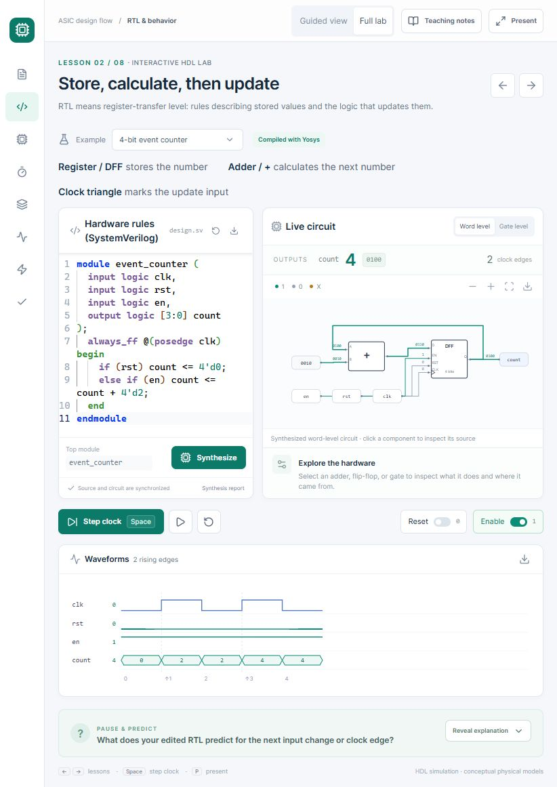

The app includes a `Procfile`, a Node 22 runtime declaration, and a Heroku build hook. Heroku startup uses the assigned `PORT` on `0.0.0.0`; local `npm start` remains at `127.0.0.1:4175`. The build prepares local editor and licensed geolocation assets before compiling Next.js. The teaching lab and synthesis can run without a database; the optional history feature uses PostgreSQL on Heroku.

See [docs/HEROKU.md](docs/HEROKU.md) for the deployment configuration, shared-demo limits, verification commands, and operating cost. The synthesis API checks accept an `ASIC_EXPLORER_URL` environment variable for checking a hosted instance.

## Private visitor history

The optional **[`/history` owner page](https://asic-explorer-narimanmani-a1aa7fa79bdd.herokuapp.com/history)** is enabled on the hosted demo. It records sampled lesson visits and approximate city/region/country behind a password sign-in, with time/lesson filters, anonymous visitor counts, and pagination. Raw IPs, GPS, and entered HDL are not stored. A public privacy notice explains the collection, and Global Privacy Control/Do Not Track requests are excluded.

History is **disabled by default** and needs private credentials and persistent PostgreSQL on Heroku. Local SQLite is available for development; production does not fall back to temporary disk. See [docs/HISTORY.md](docs/HISTORY.md) for setup, security boundaries, 30-day retention, geolocation attribution, and the separately approved database cost.

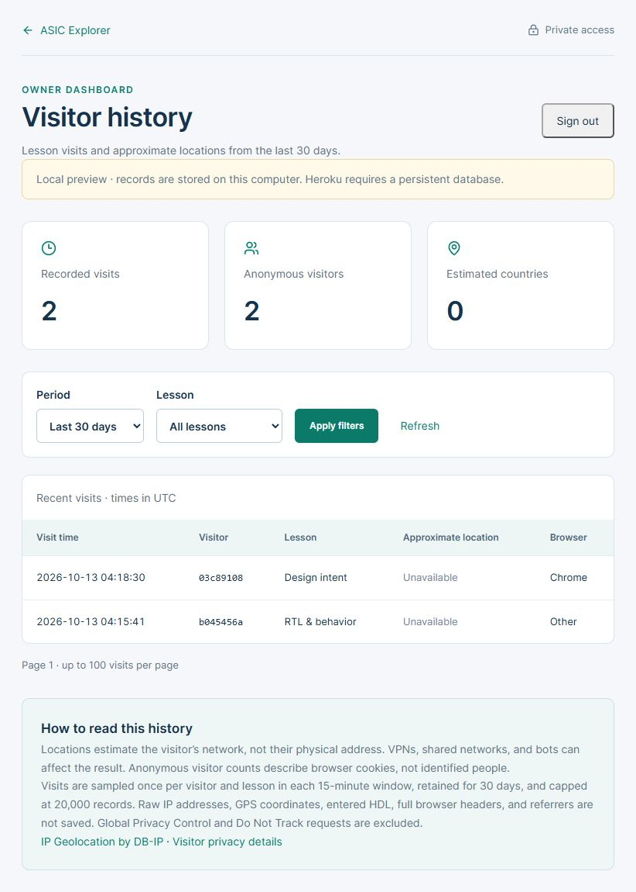

This screenshot is a local review: location is unavailable for localhost, and forwarded visitor headers are deliberately ignored there. The hosted capture policy derives approximate locations from Heroku's router peer. It does not identify the person behind that network.

## License and contributions

ASIC Explorer's original application code, documentation, screenshots, and teaching figures are available under the [MIT license](LICENSE), copyright 2026 Nariman Mani. Dependencies retain their own licenses; see [third-party notices](THIRD_PARTY_NOTICES.md), the [dependency inventory](docs/dependency-licenses.json), and the copied notices in `licenses/dependencies/`.

Educators are welcome to adapt the examples and guided practices. See [CONTRIBUTING.md](CONTRIBUTING.md) for development checks and [SECURITY.md](SECURITY.md) for local-use boundaries and the dependency-audit record. The initial [v1.0.0 release](https://github.com/narimanmani/ASIC-Explorer/releases/tag/v1.0.0) packages this teaching implementation.
